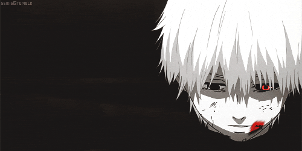
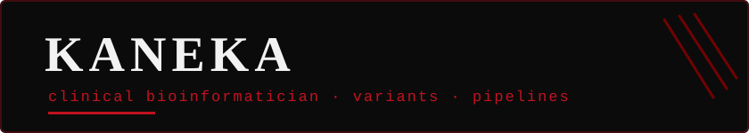

<a id="top"></a>

<div align="center">
  <a href="#about"></a>
  <a href="#kagune"></a>
  <a href="#projects"></a>
  <a href="#path"></a>
  <a href="#stats"></a>
  <a href="#favorites"></a>
</div>

<div align="center">
  
</div>

<p align="center"></p>

<div align="center">
  
</div>

<br>

<a id="about"></a>
<h3 align="center">喰 About Me</h3>

> *"Every variant tells a story. Some of them bite."*

I'm **Cleber Augusto**, a **biomedical scientist and clinical bioinformatician** from São Paulo. I work in R&D at a genomics group, building **NGS pipelines** and curating **germline and somatic variants** with ACMG/AMP and VICC/ClinGen criteria. I also take freelance bioinformatics work and teach file formats and variant annotation to people starting out.

Outside the lab I write Discord bots, port Minecraft mods, play Call of Duty Mobile and GTA RP, and watch way too much anime. I'd rather spend the night debugging a pipeline than go out, and that's a feature.

```python
kaneka = {
    "name": "Cleber Augusto",
    "role": "Clinical Bioinformatician | Variant Analyst",
    "rank": "SS",
    "kagune": ["Python", "Julia", "Bash", "Snakemake"],
    "focus": [
        "germline variant classification (ACMG/AMP)",
        "somatic oncogenicity (VICC / ClinGen / CGC)",
        "NGS pipelines, from FASTQ to report",
        "genomic data engineering with AI",
    ],
    "weakness": "the R language",
    "fuel": "energy drinks, in questionable amounts",
    "principle": "if it isn't reproducible, it didn't happen",
}
```

<br>
<p align="center"></p>
<br>

<a id="kagune"></a>
<h3 align="center">赫子 Kagune</h3>

<div align="center">

**鱗赫 Rinkaku · Genomics & Variants**
<br>


<br>

**羽赫 Ukaku · Languages**
<br>


<br>

**甲赫 Koukaku · Infra**
<br>


<br>

**尾赫 Bikaku · Bots, Mods & AI**
<br>


</div>

<br>
<p align="center"></p>
<br>

<a id="projects"></a>
<h3 align="center">喰種 Projects</h3>

<div align="center">
  <a href="https://github.com/Kaneka4850/Analisador-de-documentos">
    
  </a>
  <br>
  <sub>Structured data extraction from ~2,000 clinical images with the Gemini API, Pydantic schema validation and Docker.</sub>
  <br><br>
  <code>Python</code> <code>Pydantic</code> <code>Gemini API</code> <code>Docker</code>
</div>

<br>
<p align="center"></p>
<br>

<a id="path"></a>
<h3 align="center">経歴 Path</h3>

<div align="center">

| Period | Role | Where | What I did |
|:---:|:---:|:---:|---|
| Sep 2026 · now | Bioinformatics Analyst | **Ollin** | Classified. |
| Mar 2026 · Sep 2026 | Lead Developer | **Tiro Legal** | Structured data extraction pipeline with Python, Pydantic and Gemini 2.5 Flash. 2,000+ clinical images processed. |
| Feb 2025 · Mar 2026 | Data Assistant | **G16 Premium** | Python automation and dashboards. 15% less operational time. |
| Feb 2024 · Dec 2024 | Clinical Analysis Intern | Teaching Laboratory | 500+ samples in Biochemistry, Hematology and Microbiology. |

</div>

<details>
<summary><b>Education & certifications</b></summary>
<br>

```text
Postgraduate · Bioinformatics Applied to Medical Genomics
Somatic and Germline Variant Analysis
Hospital Israelita Albert Einstein  |  Feb 2026

B.Sc. Biomedicine
Universidade Paulista (UNIP)  |  Jan 2025
Focus: Genetics, Cytogenetics and Clinical Analysis
```

```bash
AWS_Cloud_Practitioner.cert
USP_Curso_Verao_Bioinformatica.cert
BP_Variantes_Cardio_Onco.cert
GOV_Analise_Dados_R.cert
Trissomia_Livre_Citogenetica.cert
```

</details>

<br>
<p align="center"></p>
<br>

<a id="stats"></a>
<h3 align="center">赫 Statistics</h3>

<div align="center">
  
  <br><br>
  
  
  <br><br>
  
</div>

<br>
<p align="center"></p>
<br>

<a id="favorites"></a>
<h3 align="center">喰種 Favorite Characters</h3>

<div align="center">
  
  &nbsp;
  
  &nbsp;
  
  &nbsp;
  
  <br>
  <sub>Kaneki · Juuzou · Takizawa · Arima</sub>
</div>

<br>
<p align="center"></p>
<br>

<h3 align="center">赫 Connect With Me</h3>

<div align="center">
  <a href="mailto:kaneka4850@gmail.com">
    
  </a>
  <a href="https://www.linkedin.com/in/cleberaugustobioinfo">
    
  </a>
  <a href="https://discord.com/users/443894774156623884">
    
  </a>
</div>

<br>

<div align="center">
  <sub><b>継続は力なり</b></sub>
</div>

<br>

<div align="right">
  <a href="#top">
    
  </a>
</div>
